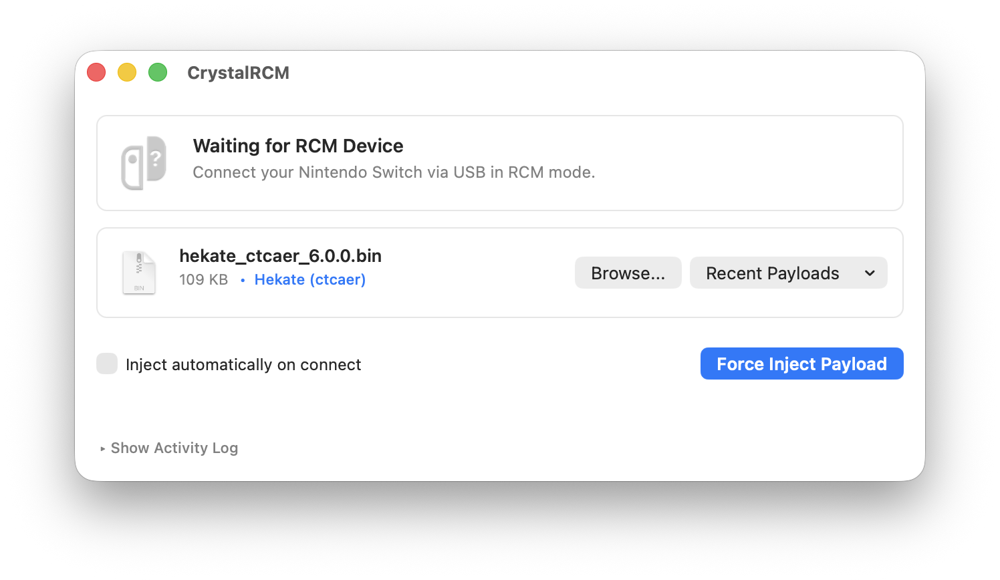

A native port of fusée-launcher with a GUI frontend for macOS (Universal). **Supports macOS >= 10.12.**

It uses native IO libraries, so doesn't require any external downloads.

All credit to Qyriad who made the [original launcher](https://github.com/Qyriad/fusee-launcher) (dead link) - this is just a Swift translation :-).

## Usage

**Issues opening unsigned applications:**

Below is an excerpt from switch.hacks.guide concerning how to open unsigned applications downloaded from the internet:

- *macOS may warn you about the application being downloaded from the internet. To get around this warning, hold the control key while clicking the application, then click Open and Open again.*
- ***macOS Sequoia users:** Apple has changed how unsigned applications from the internet are opened. You will need to follow the instructions [here](https://wiki.hacks.guide/wiki/Open_unsigned_applications_on_macOS_Sequoia) to open the application.*

Please follow the above instructions if you cannot open the app.

Drag and drop a `.bin` payload into the window, or click Browse. You can also pick from recently used payloads. Once a payload is selected and your Switch is detected in RCM, click "Inject Payload" (or enable automatic injection on USB connection).

The inject button is disabled until an RCM device and payload are ready. If you need to force an attempt without device detection, hold Shift to enable "Force Inject Payload".

Please note - the app may not work unless you move it outside of the distribution .dmg.

## Building

Open `CrystalRCM-DX.xcodeproj` in Xcode and hit build. Dependencies (USBDeviceSwift) are resolved automatically through Swift Package Manager.

## How to create (old)

If you wish to build the previous Python release, please switch to the "old" branch and follow the instructions there.

## Contact

If you run into any issues or have any questions, feel free to open an issue here, or contact me on Discord: @prayerie.

## Donation

I do not like e-begging but any donation of any amount would be very much appreciated if you find this useful (if people do donate then I'll make a new version with an about page listing donors). Currently I don't own a macbook so I have to use an extremely slow VM of macOS to work on this software.

